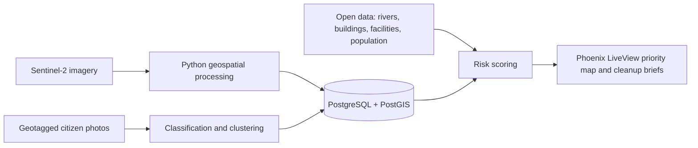

# Dumpsite Watch

Dumpsite Watch is an early-warning and cleanup-prioritization project for illegal and growing dumpsites. It is being built for the Arbiter Hacks V1 **Rethinking Waste** track. The intended system combines Sentinel-2 satellite observations for larger, established sites with geotagged citizen photos for small or new dumps, then ranks sites by size, growth, and proximity to rivers and homes.

> **Project status:** the Phoenix officer-dashboard shell, PostGIS site-record schema, and provisional explainable score are in place. A Python command can discover Sentinel-2 catalog items for a supplied study-area boundary and write a provenance manifest. The pilot county, verified reference sites, imagery processing, maps, photo reporting, and cleanup briefs are still outstanding. No detection or accuracy results are claimed.

## Planned workflow



The proposed score uses site size, growth, proximity to water, and proximity to people. The formula, weights, and supporting evidence should be shown to users so rankings are explainable. Sentinel-2 has 10 m pixels and will not reliably detect small roadside piles; citizen reports are intended to cover that gap. Cloud cover, incomplete labels, and false positives also limit satellite results.

## Repository layout

- `web/` — Elixir/Phoenix LiveView application, Ecto repository, and PostGIS extension migration.
- `geo/` — Python geospatial environment, Sentinel-2 STAC discovery command, and requirements. The virtual environment belongs in `geo/.venv/` and is ignored by Git.
- `geo/data/` — add verified, shareable reference data here. Keep downloaded imagery and generated rasters/vectors in ignored `raw/`, `processed/`, or `outputs/` subdirectories.

## Requirements

- Elixir and Erlang/OTP versions compatible with the Phoenix app (`elixir: ~> 1.17` in `web/mix.exs`)
- PostgreSQL with the PostGIS extension available
- Python 3 and `python3-venv` (for geospatial work)
- Git

## Run the Phoenix app locally

Create a PostgreSQL role/database or adjust the environment values below to match your local setup. The migration enables PostGIS, so the PostGIS extension package must be installed on the PostgreSQL server.

```sh
cd web
export PGUSER=postgres
export PGPASSWORD=postgres
mix setup
mix phx.server
```

Open <http://localhost:4000>. If port 4000 is occupied, run `PORT=4001 mix phx.server` and open <http://localhost:4001>.

`mix setup` fetches dependencies, creates and migrates the development database, runs the seed script, and builds frontend assets. The seed script is currently empty; there is no demo site dataset yet. For a different PostgreSQL host or database name, update the repository settings in `web/config/dev.exs` or use your local configuration. Do not commit passwords or production secrets.

## Prepare the Python environment

```sh
cd geo
python3 -m venv .venv
source .venv/bin/activate
python -m pip install --upgrade pip
python -m pip install -r requirements.txt
```

The requirements capture the satellite and geospatial stack. From the repository root, discover catalog items after obtaining a reviewed boundary file:

```sh
# Run from the repository root (use `cd ..` first if currently in geo/).
source geo/.venv/bin/activate
python geo/discover_sentinel2.py \
  --aoi geo/data/pilot_county.geojson \
  --start 2025-01-01 \
  --end 2025-12-31
```

The boundary must have a declared CRS and polygon geometry. The command queries the Microsoft Planetary Computer STAC catalog and writes an item metadata manifest under ignored `geo/data/raw/`. It does not download or analyze imagery, identify dumpsites, or produce validated findings. The default 20% scene cloud-cover filter is provisional and configurable with `--max-cloud`.

## Data sources and planned outputs

The project plan proposes Sentinel-2 Level-2A imagery from Microsoft Planetary Computer STAC (or Copernicus Data Space), known sites from OpenStreetMap, public records and manual review, and contextual layers from OpenStreetMap, Google Open Buildings, and WorldPop. Confirm each dataset's current terms and attribution requirements before publishing derived data.

Planned outputs include candidate site polygons, change in area over time, a transparent priority score, validation against known sites, citizen reports, and printable cleanup briefs. Add source, date, license, and validation notes for each dataset and report measured metrics only after validation has been performed.

## Development notes

- Phoenix application source and commands live in `web/`.
- Python dependencies are listed in `geo/requirements.txt`.
- Sentinel-2 item discovery lives in `geo/discover_sentinel2.py`; its output is catalog metadata only.
- The PostGIS extension migration is in `web/priv/repo/migrations/`.
- The known-sites register template is `geo/data/known_sites.csv` and currently has no records.
- No satellite imagery, verified sites, classifier, or measured model metrics are included yet.

## License

No project license has been selected yet. Add a `LICENSE` file before inviting reuse or contributions.
