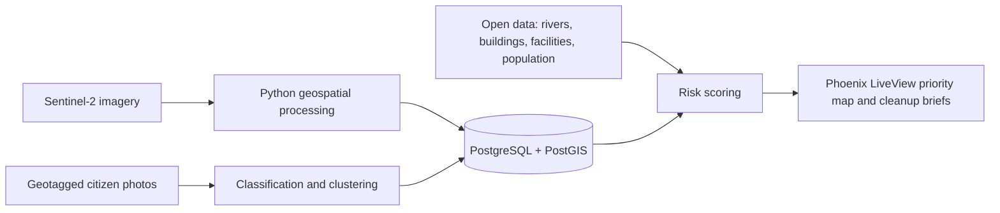

# Dumpsite Watch

Dumpsite Watch is an early-warning and cleanup-prioritization project for illegal and growing dumpsites. It is being built for the Arbiter Hacks V1 **Rethinking Waste** track. The intended system combines Sentinel-2 satellite observations for larger, established sites with geotagged citizen photos for small or new dumps, then ranks sites by size, growth, and proximity to rivers and homes.

> **Project status:** the Phoenix officer overview now shows the Nairobi boundary and ten unreviewed river-study sampling points. The points are leads, not mapped dumpsite footprints or rankings. The 2020 geoBoundaries county polygon is stored and validated as EPSG:4326. Python commands cover STAC discovery, seasonal composites, spectral indices, and reviewable candidate polygons; catalog discovery is blocked by DNS from this environment, so no satellite items or detection results are claimed.

## Planned workflow



The proposed score uses site size, growth, proximity to water, and proximity to people. The formula, weights, and supporting evidence should be shown to users so rankings are explainable. Sentinel-2 has 10 m pixels and will not reliably detect small roadside piles; citizen reports are intended to cover that gap. Cloud cover, incomplete labels, and false positives also limit satellite results.

## Repository layout

- `web/` — Elixir/Phoenix LiveView application, Ecto repository, and PostGIS extension migration.
- `geo/` — Python geospatial environment, Sentinel-2 STAC discovery command, and requirements. The virtual environment belongs in `geo/.venv/` and is ignored by Git.
- `geo/data/` — add verified, shareable reference data here. Keep downloaded imagery and generated rasters/vectors in ignored `raw/`, `processed/`, or `outputs/` subdirectories.

## Requirements

- Elixir and Erlang/OTP versions compatible with the Phoenix app (`elixir: ~> 1.17` in `web/mix.exs`)
- PostgreSQL with the PostGIS extension available
- Python 3 and `python3-venv` (for geospatial work)
- Git

## Run the Phoenix app locally

Create a PostgreSQL role/database or adjust the environment values below to match your local setup. The migration enables PostGIS, so the PostGIS extension package must be installed on the PostgreSQL server.

```sh
cd web
export PGUSER=postgres
export PGPASSWORD=postgres
mix setup
mix phx.server
```

Open <http://localhost:4000>. If port 4000 is occupied, run `PORT=4001 mix phx.server` and open <http://localhost:4001>.

`mix setup` fetches dependencies, creates and migrates the development database, runs the seed script, and builds frontend assets. The seed script is currently empty; there is no demo site dataset yet. For a different PostgreSQL host or database name, update the repository settings in `web/config/dev.exs` or use your local configuration. Do not commit passwords or production secrets.

## Prepare the Python environment

```sh
cd geo
python3 -m venv .venv
source .venv/bin/activate
python -m pip install --upgrade pip
python -m pip install -r requirements.txt
```

The requirements capture the satellite and geospatial stack. From the repository root, discover catalog items after obtaining a reviewed boundary file:

```sh
# Run from the repository root (use `cd ..` first if currently in geo/).
source geo/.venv/bin/activate
python geo/discover_sentinel2.py \
  --aoi geo/data/pilot_county.geojson \
  --start 2024-01-01 \
  --end 2025-12-31
```

The boundary must have a declared CRS and polygon geometry. The command queries the Microsoft Planetary Computer STAC catalog and writes an item metadata manifest under ignored `geo/data/raw/`. It does not download or analyze imagery, identify dumpsites, or produce validated findings. The default 20% scene cloud-cover filter is provisional and configurable with `--max-cloud`.

After reviewing imagery terms and generating a manifest, build one composite per comparison period:

```sh
python geo/build_indices.py \
  --manifest geo/data/raw/sentinel2-items.json \
  --aoi geo/data/pilot_county.geojson \
  --period early=2024-01-01/2024-03-31 \
  --period late=2025-01-01/2025-03-31
```

This writes clipped 20 m median composites and NDVI, NDBI, and bare-soil index rasters with JSON provenance sidecars under ignored `geo/data/processed/composites/`. Twenty metres matches the coarser Sentinel-2 SWIR and scene-classification bands used here. The indices are spectral inputs for later review, not dumpsite detections; no thresholds, candidate polygons, or validation metrics are produced.

Candidate polygonization is also available, but it requires explicit values for `--ndbi-min`, `--bsi-min`, `--ndvi-max`, and `--min-area-m2`. Select those values only after review against known sites.

The command writes only `unreviewed_candidates` GeoPackage features and a provenance sidecar under ignored `geo/data/outputs/`. These spectral candidates can include bare soil, construction, quarries, farms, and other false positives. No threshold values are recommended yet, and candidate outputs are not validated detections.

Review candidate polygons in a GIS tool against imagery or other evidence. In the GeoPackage, set `review_status` to `confirmed_waste`, `false_positive`, or `uncertain`, and record `review_reason`, `reviewed_by`, `reviewed_on`, and `review_evidence_url`. Keep the overall `status` as `unreviewed_candidate` until the candidate has been reviewed; these labels are reference-review outcomes, not model predictions.

## Data sources and planned outputs

The project plan proposes Sentinel-2 Level-2A imagery from Microsoft Planetary Computer STAC (or Copernicus Data Space), known sites from OpenStreetMap, public records and manual review, and contextual layers from OpenStreetMap, Google Open Buildings, and WorldPop. Confirm each dataset's current terms and attribution requirements before publishing derived data.

Nairobi is provisional because the County documented enforcement against illegal dumping at Likoni Road and Falcon Road, while NEMA reported a joint NEMA/HOT dumpsite-mapping initiative in the Nairobi–Athi–Galana–Sabaki catchment. These are leads for source collection, not a verified site register. The supplied geoBoundaries Kenya ADM1 layer is stored at `geo/data/kenya_counties.geojson`; the valid Nairobi polygon extracted from it is `geo/data/pilot_county.geojson`, with provenance in `geo/data/pilot_county.metadata.json`. The API reports 2020 representation and Public Domain, with RCMRD GeoPortal/Africa GeoPortal as source; review the linked source terms before external publication or operational use.

To fetch a fresh copy of the current geoBoundaries Kenya ADM1 layer and extract Nairobi, run `python geo/download_county_boundary.py`. This writes `geo/data/pilot_county.geojson` and a `.metadata.json` sidecar. The supplied source file has already been checked for a unique Nairobi feature and valid EPSG:4326 polygon geometry; this does not certify legal boundary accuracy.

Planned outputs include candidate site polygons, change in area over time, a transparent priority score, validation against known sites, citizen reports, and printable cleanup briefs. Add source, date, license, and validation notes for each dataset and report measured metrics only after validation has been performed.

## Development notes

- Phoenix application source and commands live in `web/`.
- Python dependencies are listed in `geo/requirements.txt`.
- Sentinel-2 item discovery lives in `geo/discover_sentinel2.py`; its output is catalog metadata only.
- Seasonal composites and spectral-index generation live in `geo/build_indices.py`; execution awaits a selected study area and sourced catalog manifest.
- Exploratory polygonization lives in `geo/polygonize_candidates.py`; operator-supplied thresholds and reference-site review are required.
- The PostGIS extension migration is in `web/priv/repo/migrations/`.
- The known-sites register is `geo/data/known_sites.csv`; it currently contains ten unreviewed study sampling points, not validated dump footprints.
- Regenerate the bundled LiveView geometry and lead data with `python geo/prepare_pilot_data.py` after changing the county boundary or reference CSV.
- The LiveView homepage shows source-backed sampling leads with explicit unreviewed labels; it does not rank them as dumpsites.
- No satellite imagery, verified sites, classifier, or measured model metrics are included yet.

## License

No project license has been selected yet. Add a `LICENSE` file before inviting reuse or contributions.
